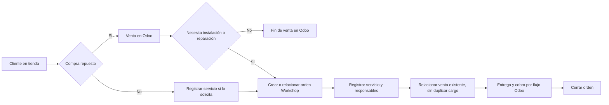
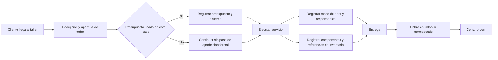
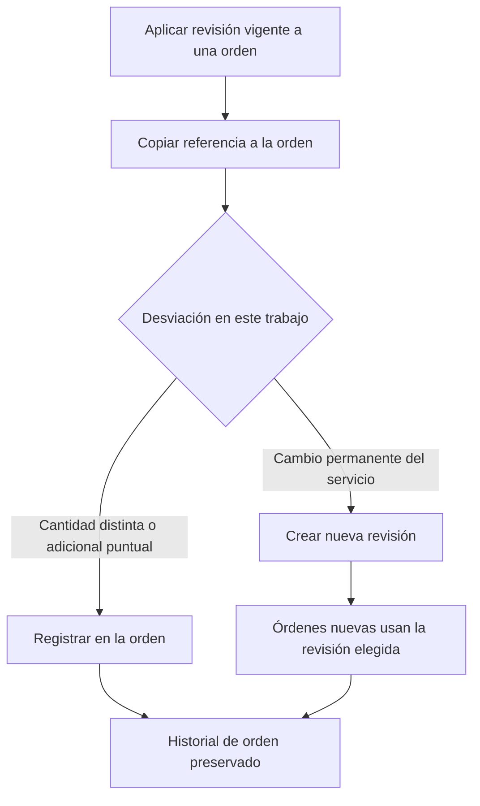

# Diagramas del flujo preliminar

## Recorrido desde tienda

## Recorrido directo al taller

## Revisión de procedimiento

Los diagramas resumen el comportamiento previsto; no sustituyen los requisitos ni resuelven las decisiones pendientes de inventario y documentos comerciales.
